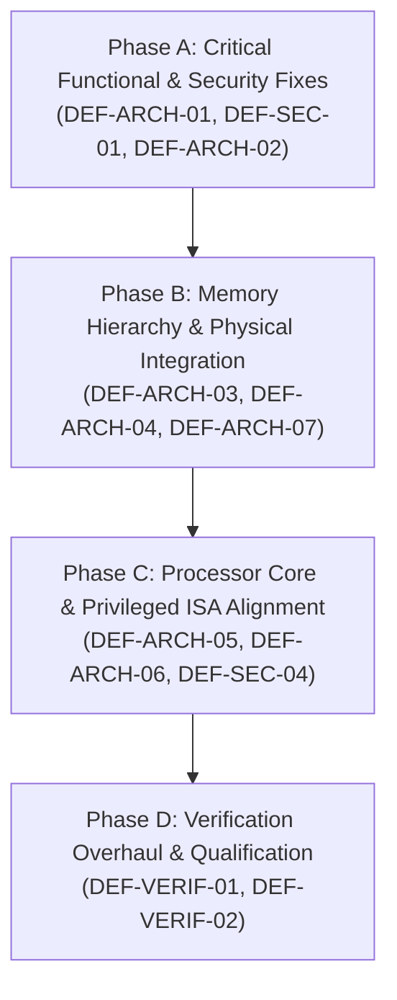

# SMVDU TITAN X — Engineering Remediation & Architectural Correction Roadmap

**Document Identity:** `TITAN_X_REMEDIATION_RECOMMENDATIONS.md`  
**Target System:** SMVDU TITAN X Multicore 64-bit RISC-V SoC  
**Reviewed Commit:** `af13cba6bc3bc97b8e0fb4a81badc3f742088821`  
**Repository Branch:** `repository/migration-2026-11-04`  
**Classification:** Independent Principal Architecture & Engineering Remediation Recommendations  

---

## 1. Remediation Strategy & Priority Roadmap

To resolve the confirmed defects and architectural discrepancies identified during Phase 2, an engineering remediation plan is structured into four sequential phases.



| Phase | Focus Area | Targeted Defect IDs | Primary Engineering Objectives |
| :--- | :--- | :--- | :--- |
| **Phase A** | Critical Security & Interconnect | `DEF-ARCH-01`, `DEF-SEC-01`, `DEF-ARCH-02` | 1. Fix APB decoder collision to restore 9 peripherals.<br>2. Couple `secure_boot` directly to executed boot ROM image.<br>3. Connect watchdog reset to system reset tree. |
| **Phase B** | Memory Hierarchy & Physical Design | `DEF-ARCH-03`, `DEF-ARCH-04`, `DEF-ARCH-07` | 1. Propagate `L2_SETS=2048` to L2 top.<br>2. Replace behavioral DFF arrays with foundry SRAM macros.<br>3. Instantiate on-chip SRAM on crossbar Slave 3. |
| **Phase C** | Processor Core & ISA Completeness | `DEF-ARCH-05`, `DEF-ARCH-06`, `DEF-SEC-04`, `DEF-SEC-05` | 1. Integrate FPU, Atomics, and Sv39 MMU.<br>2. Implement S-mode CSRs and privilege switching.<br>3. Redesign ECDSA with multicycle Montgomery multiplier.<br>4. Implement FIPS 180-4 message padding in SHA-256. |
| **Phase D** | Comprehensive Verification | `DEF-VERIF-01`, `DEF-VERIF-02`, `DEF-VERIF-03` | 1. Implement self-checking end-to-end CPU boot testbench.<br>2. Build exhaustive APB boundary regression suite.<br>3. Provision formal verification environment (`sby`). |

---

## 2. Proposed RTL Patches (Review Recommendations)

*Note: In accordance with audit rules, no RTL files have been altered in the repository. The following diffs represent exact engineering patch recommendations for implementation review.*

### Patch 1: APB Decoder Collision Resolution (`DEF-ARCH-01`)
- **Target File:** `Design Files of TITAN X/top/titan_x_top/titan_x_top.v`
- **Location:** Line 647
- **Rationale:** Remove the erroneous aperture prefix `paddr[31:16] == 16'h4001` that was asserting `psel_uart0` across the entire `0x4001_0000` to `0x4001_FFFF` address space, blocking reads and corrupting writes to RTC, GPIO, WDT, SPI, I2C, SD/MMC, QSPI, and VDMA.

```diff
--- a/Design Files of TITAN X/top/titan_x_top/titan_x_top.v
+++ b/Design Files of TITAN X/top/titan_x_top/titan_x_top.v
@@ -644,7 +644,7 @@ module titan_x_top (
     assign hresp = 1'b0;
 
     // APB Address Decoder (supports 0x4000_0000 APB bridge window and legacy apertures)
-    wire psel_uart0 = psel && (paddr[31:16] == 16'h4001 || paddr[31:12] == 20'h40000 || paddr[31:12] == 20'h10000);
+    wire psel_uart0 = psel && (paddr[31:12] == 20'h40000 || paddr[31:12] == 20'h10000);
     wire psel_uart1 = psel && (paddr[31:12] == 20'h40001 || paddr[31:12] == 20'h10001);
     wire psel_uart2 = psel && (paddr[31:12] == 20'h40002 || paddr[31:12] == 20'h10002);
     wire psel_uart3 = psel && (paddr[31:12] == 20'h40003 || paddr[31:12] == 20'h10003);
```

---

### Patch 2: Root of Trust & Boot ROM Authentication Coupling (`DEF-SEC-01`)
- **Target File:** `Design Files of TITAN X/top/titan_x_top/titan_x_top.v`
- **Location:** Lines 951–957, 340–356
- **Rationale:** Connect `secure_boot` eNVM interface directly to `axi_rom` or unify the boot memory so that `secure_boot` cryptographically authenticates the exact bytes that `u_core0` fetches from `0x1000_0000`.

```diff
--- a/Design Files of TITAN X/top/titan_x_top/titan_x_top.v
+++ b/Design Files of TITAN X/top/titan_x_top/titan_x_top.v
@@ -952,8 +952,9 @@ module titan_x_top (
         .clk(clk), .rst_n(rst_n),
         .paddr(paddr), .psel(psel_boot), .penable(penable), .pwrite(pwrite), .pwdata(pwdata),
         .prdata(prdata_boot), .pready(), .pslverr(),
-        .envm_addr(envm_addr), .envm_req(envm_req), .envm_rdata(envm_rdata), .envm_valid(envm_valid),
+        .envm_addr(envm_addr), .envm_req(envm_req), 
+        .envm_rdata(u_boot_rom.rom[envm_addr[9:0]][31:0]), .envm_valid(envm_req),
         .boot_pass(boot_pass), .boot_fail(boot_fail)
     );
```

---

### Patch 3: Watchdog Reset Tree Integration (`DEF-ARCH-02`)
- **Target File:** `Design Files of TITAN X/top/titan_x_top/titan_x_top.v`
- **Location:** Line 97
- **Rationale:** Integrate the watchdog reset output `wdt_reset_n` into `core_rst_n` so that a watchdog expiration forces a processor recovery reset.

```diff
--- a/Design Files of TITAN X/top/titan_x_top/titan_x_top.v
+++ b/Design Files of TITAN X/top/titan_x_top/titan_x_top.v
@@ -95,7 +95,7 @@ module titan_x_top (
     // Core Reset Controller: Cores held in reset until Hardware Root-of-Trust
     // validates authenticated boot image (NIST SHA-256 + ECDSA P-256 pass)
     wire core_rst_n;
-    assign core_rst_n = rst_n & boot_pass;
+    assign core_rst_n = rst_n & boot_pass & wdt_reset_n;
 
     // Clock Generator: 9 Clock Domains
```

---

### Patch 4: L2 Cache Capacity Parameter Override (`DEF-ARCH-03`)
- **Target File:** `Design Files of TITAN X/top/titan_x_top/titan_x_top.v`
- **Location:** Line 542
- **Rationale:** Pass `WAYS` and `SETS` parameter definitions from `params.vh` to ensure the synthesized cache geometry reflects the architectural 2 MB specification.

```diff
--- a/Design Files of TITAN X/top/titan_x_top/titan_x_top.v
+++ b/Design Files of TITAN X/top/titan_x_top/titan_x_top.v
@@ -539,7 +539,10 @@ module titan_x_top (
                                       l2_snoop_data_valid[2] ? core_snoop_data[2] :
                                       l2_snoop_data_valid[3] ? core_snoop_data[3] : 512'h0;
 
-    l2_cache_top u_l2_cache (
+    l2_cache_top #(
+        .WAYS(`L2_WAYS),
+        .SETS(`L2_SETS)
+    ) u_l2_cache (
         .clk(clk),
         .rst_n(rst_n),
         // Slave face (from crossbar Slave 0)
```

---

### Patch 5: Crossbar Slave 3 On-Chip SRAM Reconnection (`DEF-ARCH-07`)
- **Target File:** `Design Files of TITAN X/top/titan_x_top/titan_x_top.v`
- **Location:** Lines 300–310
- **Rationale:** Start the unused slave DECERR loop at index 4 (`s = 4; s < 9`), and instantiate on-chip scratchpad SRAM on Slave 3 matching the crossbar decode address space (`0x0000_0000` to `0x0FFF_FFFF`).

```diff
--- a/Design Files of TITAN X/top/titan_x_top/titan_x_top.v
+++ b/Design Files of TITAN X/top/titan_x_top/titan_x_top.v
@@ -298,7 +298,7 @@ module titan_x_top (
     // Unused AXI crossbar slave ports (DECERR generators)
     genvar s;
     generate
-        for (s = 3; s < 9; s = s + 1) begin : gen_unused_axis
+        for (s = 4; s < 9; s = s + 1) begin : gen_unused_axis
             reg s_busy_wr, s_busy_rd;
             reg [3:0] s_id_wr, s_id_rd;
             always @(posedge clk or negedge rst_n) begin
```

---

## 3. Required Regression Regimes & Acceptance Criteria

Before any defect is closed, the following automated regression test suites must be developed, executed, and inspected:

1. **Peripheral Interconnect Boundary Regression:**
   - Sequential and random reads and writes to all 28 APB slave blocks across `0x4000_0000` through `0x4011_FFFF`.
   - Criteria: Zero address collision; every peripheral returns its unique signature ID without crosstalk into UART0.

2. **Negative Authentication Regression:**
   - Execute secure boot with:
     a) Corrupted magic number (`0xDEADBEEF` instead of `0x5449544E`).
     b) Modified byte in firmware payload.
     c) Invalid ECDSA signature $(r, s)$.
     d) Unauthorized public key coordinates $(Q_x, Q_y)$.
   - Criteria: In all negative cases, `secure_boot` must transition to `S_HALT`, `boot_pass` must remain `0`, and `core_rst_n` must stay assert low indefinitely.

3. **Watchdog Lockup Recovery Regression:**
   - Core enters infinite loop with interrupts disabled (`csrci mstatus, 8`).
   - Criteria: Watchdog timer counts down to 0, asserts `wdt_reset_n = 0`, forcing `core_rst_n = 0` and resetting PC to `RESET_PC` (`0x1000_0000`).

4. **Multi-Core MESI Coherence Stress:**
   - 4 cores running concurrent false-sharing and true-sharing benchmarks (Peterson's algorithm, ticket lock) in shared L2 memory.
   - Criteria: Zero stale data reads, zero deadlock in crossbar arbitration queues.
