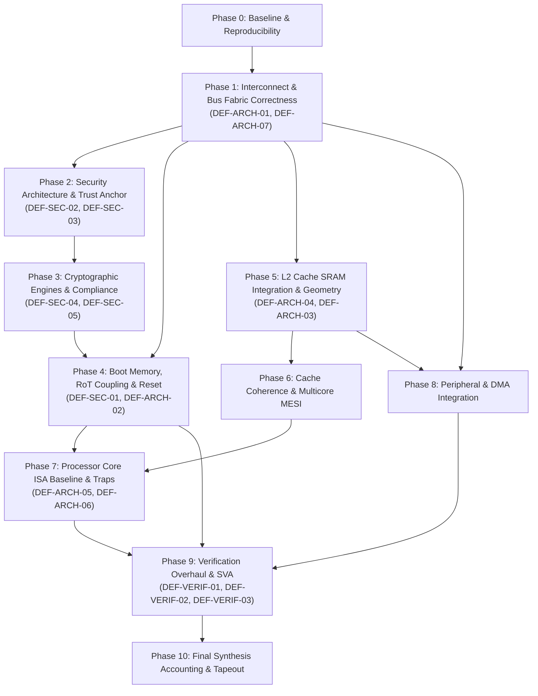

# SMVDU TITAN X — Master Engineering Remediation Roadmap

**Document Identity:** `TITAN_X_REMEDIATION_ROADMAP.md`  
**Target System:** SMVDU TITAN X Multicore 64-bit RISC-V SoC  
**Reviewed Commit:** `af13cba6bc3bc97b8e0fb4a81badc3f742088821`  
**Repository Branch:** `repository/migration-2026-11-04`  
**Classification:** Master Architectural Remediation Roadmap & Execution Plan  

---

## 1. Executive Summary & Baseline Identity

This roadmap provides the master engineering strategy and dependency-aware phase sequencing to remediate all 15 confirmed architectural defects, security vulnerabilities, and verification gaps established during the Phase 2 audit of the **SMVDU TITAN X** SoC.

### Baseline Check
- **Repository:** `https://github.com/anupamsarashwat1-cloud/TITAN-X-2026-11-04.git`
- **Branch:** `repository/migration-2026-11-04`
- **Exact Reviewed Commit SHA:** `af13cba6bc3bc97b8e0fb4a81badc3f742088821`
- **Working Tree:** Pristine (zero source modifications permitted during planning)
- **Defects Under Remediation:** 15 confirmed findings documented in [`TITAN_X_DEFECT_REGISTER.csv`](file:///home/anupam-sarashwat/TITAN-X-2026-11-04/TITAN_X_DEFECT_REGISTER.csv)

---

## 2. Master Dependency Graph & Phase Sequencing

The remediation workflow is structured into 11 strictly ordered, dependency-checked phases. No task may begin until all prerequisite tasks and architectural decision gates are satisfied.

---

## 3. Detailed Phase Breakdown & Execution Gates

### Phase 0: Baseline Environment & Reproducibility Harness
- **Objective:** Establish an automated, deterministic regression harness to compile and simulate all existing modules, recording exit codes without manual log inspection.
- **Key Tasks:** `TASK-00-01`
- **Exit Gate:** All compilable unit testbenches run automatically; baseline pass/fail matrix recorded.

### Phase 1: Interconnect & Bus Fabric Correctness
- **Objective:** Fix the fatal APB decoder address collision that blinds 9 peripherals, and map on-chip SRAM to crossbar Slave 3.
- **Key Tasks:** `TASK-01-01` (`DEF-ARCH-01`), `TASK-01-02` (`DEF-ARCH-07`)
- **Key Decisions:** `ADR-06` (Strict 4KB page APB decoding)
- **Exit Gate:** Independent, unmasked read/write capability to all 28 APB slaves and Slave 3 SRAM verified in simulation.

### Phase 2: Security Architecture & Trust Anchor
- **Objective:** Replace immutable RTL-gate public keys with a 4-slot OTP eFuse model and integrate monotonic anti-rollback counters.
- **Key Tasks:** `TASK-02-01` (`DEF-SEC-02`), `TASK-02-02` (`DEF-SEC-03`)
- **Key Decisions:** `ADR-02` (eFuse Key Slot Model), `ADR-03` (Boot Header Format)
- **Exit Gate:** Key revocation and anti-rollback downgrade rejection verified in `tb_secure_boot.v`.

### Phase 3: Cryptographic Engines & Compliance
- **Objective:** Add FIPS 180-4 compliant message padding to SHA-256 and redesign the ECDSA P-256 engine with a synthesizable multicycle Montgomery multiplier.
- **Key Tasks:** `TASK-03-01` (`DEF-SEC-04`), `TASK-03-02` (`DEF-SEC-05`)
- **Key Decisions:** `ADR-04` (Multicycle Montgomery Multiplier)
- **Exit Gate:** SHA-256 matches NIST CAVP vectors for arbitrary lengths; ECDSA synthesizes in Yosys without hanging and closes timing at >= 50 MHz.

### Phase 4: Boot Memory, RoT Coupling & Reset Integration
- **Objective:** Cryptographically couple `secure_boot` directly to the `axi_rom` boot image and connect the watchdog reset net to system reset.
- **Key Tasks:** `TASK-04-01` (`DEF-SEC-01`), `TASK-04-02` (`DEF-ARCH-02`)
- **Key Decisions:** `ADR-01` (RoT Coupling to Boot ROM), `ADR-07` (Watchdog Reset Integration)
- **Exit Gate:** CPU boots only when `firmware.hex` is authentic; tampering halts boot; watchdog expiration forces clean reboot.

### Phase 5: L2 Cache SRAM Integration & Geometry Closure
- **Objective:** Replace flat behavioral DFF arrays with instantiated foundry SRAM macros (`sram_32x64_180nm`) and propagate target capacity parameters.
- **Key Tasks:** `TASK-05-01` (`DEF-ARCH-04`), `TASK-05-02` (`DEF-ARCH-03`)
- **Key Decisions:** `ADR-05` (L2 Cache Physical Banking)
- **Exit Gate:** L2 cache operates with 1-cycle synchronous SRAM macros; cell area reduced by >70% in synthesis; no address folding.

### Phase 6: Cache Coherence & Multicore MESI
- **Objective:** Validate multicore MESI snooping, directory invalidations, and dirty-line interventions across Cores 0–3 on the new SRAM-backed L2 cache.
- **Key Tasks:** `TASK-06-01`
- **Exit Gate:** Concurrent false-sharing and true-sharing stress tests pass with zero stale reads or memory corruption.

### Phase 7: Processor Core ISA Baseline & Traps
- **Objective:** Formally baseline the core as RV64IM_Zicsr Machine-Mode, qualify trap handling, and reconcile unintegrated repository modules.
- **Key Tasks:** `TASK-07-01` (`DEF-ARCH-05`), `TASK-07-02` (`DEF-ARCH-06`)
- **Key Decisions:** `ADR-08` (Core Capability Roadmap)
- **Exit Gate:** Core passes official `riscv-tests/rv64ui` and `rv64um`; top-level SoC elaborates with zero undriven nets.

### Phase 8: Peripheral & DMA Integration
- **Objective:** Validate concurrent high-speed DMA bus traffic (Ethernet, PCIe, USB, VDMA) into DDR4 memory while CPU cores execute code.
- **Key Tasks:** `TASK-08-01`
- **Exit Gate:** Multi-master crossbar arbitration operates without starvation or memory data corruption.

### Phase 9: Verification Overhaul & Coverage Closure
- **Objective:** Replace vacuous pin-toggle testbenches with genuine CPU boot regressions, de-mock integration testbenches, and catalog formal SVA properties.
- **Key Tasks:** `TASK-09-01` (`DEF-VERIF-01`), `TASK-09-02` (`DEF-VERIF-02`), `TASK-09-03` (`DEF-VERIF-03`)
- **Exit Gate:** `tb_titan_x_top.v` verifies software execution and UART0 output; boundary regression passes 100%.

### Phase 10: Final Synthesis Accounting & Tapeout Sign-Off
- **Objective:** Execute full-chip gate-level synthesis with Yosys, verify timing closure, and reconcile project qualification documentation.
- **Key Tasks:** `TASK-10-01`
- **Exit Gate:** Clean gate-level netlist; zero unmapped blackboxes; full documentation sign-off.

---

## 4. Risk Register & Contingency Matrix

| Risk ID | Description | Severity | Probability | Contingency Mitigation Strategy |
| :--- | :--- | :---: | :---: | :--- |
| **RSK-01** | Multicycle ECDSA engine exceeds area budget | High | Medium | Use digit-serial radix-4 Montgomery multiplier or optimize Straus precomputation tables. |
| **RSK-02** | Synchronous SRAM 1-cycle latency causes cache FSM pipeline bubble | Medium | High | Introduce 1-cycle lookahead address register in cache hit detection logic. |
| **RSK-03** | Host formal toolchain (`sby`) remains unavailable | Medium | High | Maintain portable SystemVerilog Assertions (`sva_inventory.md`) executable on external formal servers. |
| **RSK-04** | Watchdog reset pulse causes reset race condition across asynchronous clocks | High | Low | Route `wdt_reset_n` through `reset_sync.v` multi-flop synchronizers on all 9 clock domains. |
