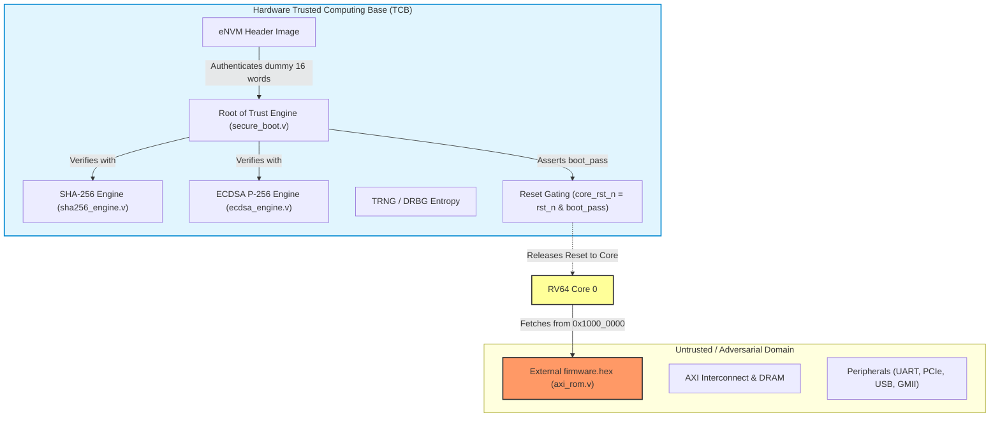

# SMVDU TITAN X — Hardware Security Threat Model & Cryptographic Vulnerability Audit

**Document Identity:** `TITAN_X_SECURITY_THREAT_MODEL.md`  
**Target System:** SMVDU TITAN X Multicore 64-bit RISC-V SoC  
**Reviewed Commit:** `af13cba6bc3bc97b8e0fb4a81badc3f742088821`  
**Repository Branch:** `repository/migration-2026-11-04`  
**Classification:** Independent Principal Security Audit & Threat Assessment  

---

## 1. Executive Summary & Security Objectives

This document establishes the comprehensive hardware security threat model, cryptographic trust anchor evaluation, and vulnerability surface audit for the **SMVDU TITAN X** SoC. 

The primary security objectives of the TITAN X SoC hardware architecture are:
1. **Root-of-Trust (RoT) Integrity:** Ensure the application processor cores (Cores 0–3) and Monitor Core execute only cryptographically verified, authentic, and authorized firmware.
2. **Confidentiality & Isolation:** Enforce memory boundary protection via Physical Memory Protection (PMP) and Memory Protection Units (MPU) across distinct software privilege states.
3. **Cryptographic Assurance:** Provide NIST FIPS-compliant cryptographic primitives (SHA-256 integrity, ECDSA P-256 digital signature verification, True Random Number Generation) for attestation, secure communication, and secure boot.
4. **Fail-Closed Resilience:** Guarantee that upon any cryptographic verification failure, timeout, or anomalous state, the processor remains permanently locked in reset (`core_rst_n = 0`), preventing execution of compromised code.

### Summary of Major Security Findings
- **CRITICAL Vulnerability (DEF-SEC-01 / CWE-347):** Complete decoupling of the authenticated eNVM payload from the executed boot ROM firmware. The hardware Root of Trust verifies a dummy 16-word internal test array, while the cores execute completely unauthenticated code loaded from external `firmware.hex` in `axi_rom`.
- **HIGH Vulnerability (DEF-SEC-02 / CWE-1393):** Immutable Root Public Key hardcoded in silicon logic gates (`localparam` in RTL) with zero OTP/eFuse key provisioning, rotation, or revocation capability.
- **HIGH Vulnerability (DEF-SEC-04 / Cryptographic Flaw):** Non-compliant SHA-256 implementation lacking FIPS 180-4 message padding and length encoding; standard cryptographic signatures computed by industry tools fail verification in hardware.
- **HIGH Vulnerability (DEF-SEC-05 / Non-Synthesizable Logic):** ECDSA P-256 engine uses single-cycle combinational 256x256-bit multiplication and 512-bit modulo division, resulting in massive timing violations that prevent physical synthesis.
- **MEDIUM Vulnerability (DEF-SEC-03 / CWE-1037):** Absolute omission of monotonic anti-rollback counters in the boot header, permitting downgrade attacks.

---

## 2. Attacker Capabilities & Threat Profiles

The threat model assumes an attacker with capabilities spanning remote, software, and physical interfaces.

| Threat Profile | Access Level | Attacker Capabilities | Assets Targeted |
| :--- | :--- | :--- | :--- |
| **T1: External Storage Tampering** | Physical / In-System | Reprogramming or modifying external SPI flash, eMMC, or ROM contents (`firmware.hex`). | Firmware integrity, boot sequence hijacking, malware injection. |
| **T2: Bus Sniffing & Injection** | Board-level Physical | Probing inter-chip buses (DDR4 DQS/DQ, SPI, I2C, UART) or injecting electrical faults. | Plaintext credentials, unencrypted payload tampering. |
| **T3: Malicious Software / Hostile Driver** | Local OS / User Mode | Executing arbitrary instructions in software; exploiting MMU/PMP holes or buffer overflows. | Machine-mode CSRs, cryptographic key registers, peripheral configuration. |
| **T4: Supply Chain & Firmware Rollback** | Lifecycle / Logistics | Flashing older, legitimate, previously-signed firmware containing known software vulnerabilities. | Monotonic security counters, deprecated crypto keys. |
| **T5: Fault Injection & Glitching** | Physical Lab | Power supply glitching, clock glitching, or EMFI targeting reset release and FSM state registers. | `boot_pass` signal gating, state transitions in `secure_boot.v`. |

---

## 3. Trusted Computing Base (TCB) Definition & Boundaries

The Trusted Computing Base (TCB) consists of the hardware components, execution states, and firmware that must be trusted for the system's security guarantees to hold.

### Hardware TCB
1. **Clock & Reset Generation:** [reset_sync.v](file:///home/anupam-sarashwat/TITAN-X-2026-11-04/Design%20Files%20of%20TITAN%20X/common/reset_sync/reset_sync.v) and the reset release gating in [titan_x_top.v](file:///home/anupam-sarashwat/TITAN-X-2026-11-04/Design%20Files%20of%20TITAN%20X/top/titan_x_top/titan_x_top.v#L97-L98).
2. **Secure Boot Engine:** [secure_boot.v](file:///home/anupam-sarashwat/TITAN-X-2026-11-04/Design%20Files%20of%20TITAN%20X/security/secure_boot/secure_boot.v) FSM.
3. **Cryptographic Cores:** [sha256_engine.v](file:///home/anupam-sarashwat/TITAN-X-2026-11-04/Design%20Files%20of%20TITAN%20X/peripherals/sha256_engine/sha256_engine.v) and [ecdsa_engine.v](file:///home/anupam-sarashwat/TITAN-X-2026-11-04/Design%20Files%20of%20TITAN%20X/security/ecdsa_engine/ecdsa_engine.v).
4. **Boot Memory:** Embedded non-volatile memory ([envm_ctrl.v](file:///home/anupam-sarashwat/TITAN-X-2026-11-04/Design%20Files%20of%20TITAN%20X/security/envm_ctrl/envm_ctrl.v)) and Boot ROM ([axi_rom.v](file:///home/anupam-sarashwat/TITAN-X-2026-11-04/Design%20Files%20of%20TITAN%20X/top/axi_rom/axi_rom.v)).
5. **Entropy Source:** [trng.v](file:///home/anupam-sarashwat/TITAN-X-2026-11-04/Design%20Files%20of%20TITAN%20X/peripherals/trng/trng.v) ring-oscillator entropy collector and [drbg.v](file:///home/anupam-sarashwat/TITAN-X-2026-11-04/Design%20Files%20of%20TITAN%20X/security/drbg/drbg.v).



---

## 4. Cryptographic Trust Anchor & Implementation Review

### 4.1 Root Public Key Storage & Immutability (DEF-SEC-02)
In [secure_boot.v:38-40](file:///home/anupam-sarashwat/TITAN-X-2026-11-04/Design%20Files%20of%20TITAN%20X/security/secure_boot/secure_boot.v#L38-L40):
```verilog
    localparam [255:0] ROT_PUBKEY_QX = 256'h26F4FA43_1A2BEB66_46D953CA_332BC722_911D9B05_E5D92476_06330B61_E6703F52;
    localparam [255:0] ROT_PUBKEY_QY = 256'h9E9689C9_49B37A0B_342F6CAC_9B4E5440_A727CEE4_055285CD_A6216084_643D6E4F;
```
The public key is hardwired in standard-cell gates.
- **Can an untrusted image supply its own public key?**  
  **No.** In [secure_boot.v:238-249](file:///home/anupam-sarashwat/TITAN-X-2026-11-04/Design%20Files%20of%20TITAN%20X/security/secure_boot/secure_boot.v#L238-L249), the FSM explicitly compares incoming public key coordinates against `rot_qx_word` and `rot_qy_word`. If they do not match, `auth_fail <= 1'b1; state <= S_HALT;`. An arbitrary public key is rejected.
- **The Core Flaw:** The key cannot be rotated or revoked. Standard secure SoC architectures store a cryptographic hash of the public key in One-Time Programmable (OTP) eFuses, supporting primary and secondary keys with revocation flags.

### 4.2 NIST FIPS 180-4 SHA-256 Engine Analysis (DEF-SEC-04)
Standard SHA-256 (FIPS 180-4 Section 5.1.1) mandates:
1. Message padding: Append a single `1` bit (`0x80` byte).
2. Zero padding: Append $k$ zero bits such that $(L + 1 + k) \equiv 448 \pmod512$.
3. Length encoding: Append a 64-bit big-endian representation of the original length $L$.
4. A 512-bit message requires 2 blocks: Block 1 has the message, Block 2 has `0x80`, zeros, and `64'd512`.

**Actual Implementation in [sha256_engine.v](file:///home/anupam-sarashwat/TITAN-X-2026-11-04/Design%20Files%20of%20TITAN%20X/peripherals/sha256_engine/sha256_engine.v):**
- The engine exposes a 16-word input buffer `msg_block[0:15]` ([sha256_engine.v:56](file:///home/anupam-sarashwat/TITAN-X-2026-11-04/Design%20Files%20of%20TITAN%20X/peripherals/sha256_engine/sha256_engine.v#L56)).
- It does **zero** padding. It executes the 64-round compression directly on the 16 written words.
- In [secure_boot.v:280-316](file:///home/anupam-sarashwat/TITAN-X-2026-11-04/Design%20Files%20of%20TITAN%20X/security/secure_boot/secure_boot.v#L280-L316), words from eNVM are fed raw. For the 16-word test image, exactly one compression is run.
- **Cryptographic Result:** The computed digest is not the SHA-256 hash of a 512-bit message; it is a raw Davies-Meyer block transformation $H_1 = H_0 + C(H_0, M)$. Any standard tool generating FIPS 180-4 compliant signatures will generate hashes that fail hardware authentication.

### 4.3 NIST FIPS 186-4 ECDSA P-256 Engine Analysis (DEF-SEC-05)
In [ecdsa_engine.v](file:///home/anupam-sarashwat/TITAN-X-2026-11-04/Design%20Files%20of%20TITAN%20X/security/ecdsa_engine/ecdsa_engine.v):
- The algorithm implements genuine Jacobian projective point doubling and addition with binary Extended Euclidean Algorithm (EEA) for inversion.
- **Hardware Synthesis Violation:** Lines 108–115 and 135–142 declare:
  ```verilog
  function [255:0] mod_mul_p;
      input [255:0] x, y;
      reg [511:0] prod;
      begin
          prod = x * y;
          mod_mul_p = prod % P_256;
      end
  endfunction
  ```
- Modular multiplication is declared as a single-cycle combinational function.
- In `S_STRAUS` ([ecdsa_engine.v:312-338](file:///home/anupam-sarashwat/TITAN-X-2026-11-04/Design%20Files%20of%20TITAN%20X/security/ecdsa_engine/ecdsa_engine.v#L312-L338)), `jac_double` is invoked (10 sequential `mod_mul_p` operations), followed by two `jac_add_aff` calls (8 sequential `mod_mul_p` operations each).
- Chaining up to 26 256-bit multiplications and 512-bit modulo dividers in one clock cycle requires a logic depth of hundreds of thousands of gates, making synthesis timing closure impossible at any operational frequency.

---

## 5. Detailed Vulnerability Surface Analysis

### 5.1 DEF-SEC-01: Decoupling of Authenticated Image and Executed Firmware (CRITICAL)
- **Vulnerability ID:** `DEF-SEC-01`
- **CWE:** CWE-347 (Improper Verification of Cryptographic Signature), CWE-1274 (Insecure Default Configuration of Root of Trust)
- **Attack Vector:** An attacker with write access to external storage or JTAG modifies the binary payload in `firmware.hex` (loaded into `axi_rom`).
- **Mechanism:**
  1. On power-on, `rst_n` deasserts.
  2. `secure_boot` reads the hardcoded 59-word table in `envm_image` ([titan_x_top.v:881-956](file:///home/anupam-sarashwat/TITAN-X-2026-11-04/Design%20Files%20of%20TITAN%20X/top/titan_x_top/titan_x_top.v#L881-L956)).
  3. `envm_image` contains valid pre-calculated signature fields for 16 dummy test words (`0x10000000` to `0x1000003C`).
  4. ECDSA verification succeeds; `secure_boot` asserts `boot_pass = 1'b1`.
  5. In [titan_x_top.v:97-98](file:///home/anupam-sarashwat/TITAN-X-2026-11-04/Design%20Files%20of%20TITAN%20X/top/titan_x_top/titan_x_top.v#L97-L98):
     ```verilog
     assign core_rst_n = rst_n & boot_pass;
     ```
  6. The core resets and vectors to `RESET_PC = 64'h0000_0000_1000_0000` ([titan_x_top.v:397](file:///home/anupam-sarashwat/TITAN-X-2026-11-04/Design%20Files%20of%20TITAN%20X/top/titan_x_top/titan_x_top.v#L397)).
  7. Address `0x1000_0000` is Slave 2 on the AXI crossbar, which routes to `u_boot_rom` ([axi_rom.v](file:///home/anupam-sarashwat/TITAN-X-2026-11-04/Design%20Files%20of%20TITAN%20X/top/axi_rom/axi_rom.v)).
  8. `axi_rom` serves the attacker's unauthenticated bytecode from `firmware.hex`.
- **Impact:** Total compromise. The hardware Root of Trust acts as a cosmetic check, granting full system execution privileges to arbitrary code.

### 5.2 DEF-SEC-03: Firmware Rollback / Downgrade Attack (MEDIUM)
- **Vulnerability ID:** `DEF-SEC-03`
- **CWE:** CWE-1037 (Processor Initialization with Sensitive Status Flags)
- **Mechanism:** The image header decoded in [secure_boot.v:216-260](file:///home/anupam-sarashwat/TITAN-X-2026-11-04/Design%20Files%20of%20TITAN%20X/security/secure_boot/secure_boot.v#L216-L260) consists solely of:
  - Word 0: Magic (`0x5449544E`)
  - Word 1: Length (`img_len`)
  - Word 2: Public Key ID
  - Words 3–10: Expected Digest
  - Words 11–26: Public Key Coordinates
  - Words 27–42: ECDSA Signature $(r, s)$
- There is no security version, build timestamp, or monotonic revision number. An attacker who obtains an older, vulnerable firmware version signed with the valid root key can downgrade the device at will.

### 5.3 Reset Release Gating & Fail-Closed Behavior
- **Evaluation:** In [secure_boot.v:477-478](file:///home/anupam-sarashwat/TITAN-X-2026-11-04/Design%20Files%20of%20TITAN%20X/security/secure_boot/secure_boot.v#L477-L478):
  ```verilog
  assign boot_pass = (state == S_SUCCESS);
  assign boot_fail = (state == S_HALT);
  ```
- If an authentication failure occurs, `state` enters `S_HALT`. `S_HALT` has no exit transitions except via asynchronous hardware reset `rst_n`.
- The logic is properly **fail-closed** regarding its internal FSM. However, because the gating controls only `core_rst_n`, peripheral bus masters (Ethernet DMA, PCIe, USB, VDMA) are released while the core is locked in reset. A hostile DMA device can initiate transactions across the crossbar even if secure boot fails.

---

## 6. Threat Mitigation Matrix

| Defect ID | Threat Addressed | Required Architectural Remediation | Target Component |
| :--- | :--- | :--- | :--- |
| **DEF-SEC-01** | Firmware spoofing & malware execution | Route `axi_rom` slave requests through `secure_boot`, or have `secure_boot` hash the physical boot ROM address space before asserting `boot_pass`. | `titan_x_top.v`, `secure_boot.v`, `axi_rom.v` |
| **DEF-SEC-02** | Irrevocable key compromise | Integrate a 1024-bit OTP eFuse macro storing 4 root key hashes and revocation bitmasks. | `secure_boot.v`, new `efuse_ctrl.v` |
| **DEF-SEC-03** | Firmware downgrade / replay | Add a 32-bit security counter to the header; compare against an internal monotonic eFuse register. | `secure_boot.v` |
| **DEF-SEC-04** | Cryptographic signature rejection | Implement automatic FIPS 180-4 padding (append `0x80`, zero-pad to 448 bits, append 64-bit length) in hardware. | `sha256_engine.v`, `secure_boot.v` |
| **DEF-SEC-05** | Synthesis timing failure & hang | Re-architect ECDSA P-256 scalar multiplication using a multicycle Montgomery multiplier. | `ecdsa_engine.v` |
| **NEW-SEC-06** | Unauthorized DMA during boot fault | Gate `interconnect_rst_n` and peripheral resets with `boot_pass` to prevent rogue DMA when cores are halted. | `titan_x_top.v` |
